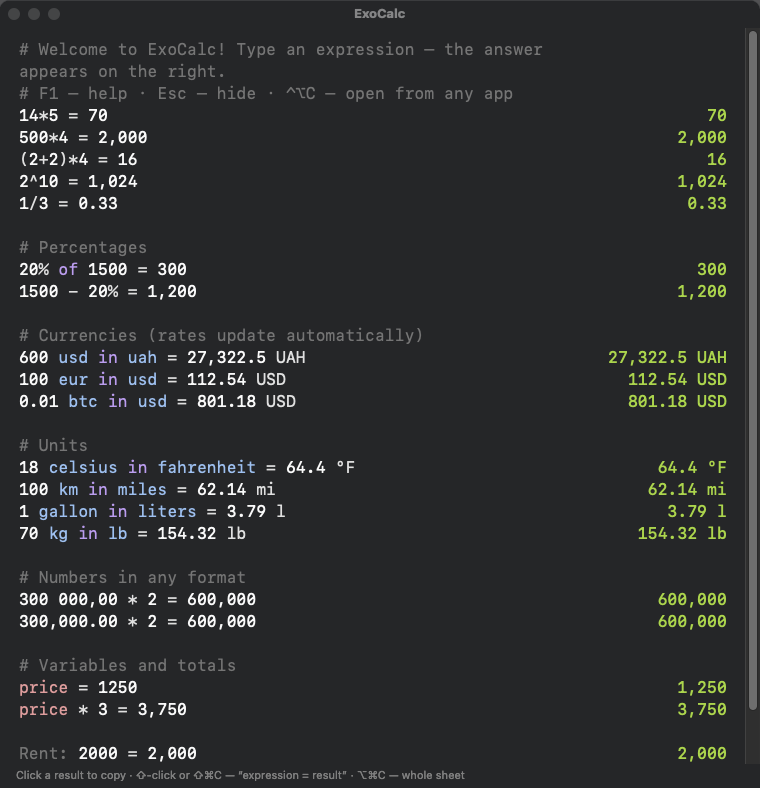

# ExoCalc

**[English](#english) · [Українська](#українська) · [Русский](#русский)**

    

<p align="center"></p>

---

## English

ExoCalc is a minimalist notepad calculator for macOS and Windows. Type calculations line by line and the result appears on the right. It converts currencies (world rates, the official NBU hryvnia rate, crypto) and units, and understands plain English, Ukrainian and Russian words.

### Features

- **Any arithmetic:** `+ - * / ^ mod !`, parentheses, `800x12`, `0xFF`, `1e6`, `5k`, `2.5 million`
- **Numbers in any format:** `300,000.00` · `300 000,00` · `30000,00` · `1.234.567`
- **Percentages:** `100 + 15%`, `15% of 800`, `20% off 1500`
- **Currencies:** `600 usd in uah`, `$20 + €15`, `0.05 btc in usd`. About 160 currencies plus BTC, ETH, USDT, SOL, TON and more; hryvnia at the official NBU rate (optional); rates cached for offline use
- **Units:** length, area, volume, mass, time, temperature, data, speed, angle, energy, power, pressure, frequency: `18 celsius in fahrenheit`, `100 km in miles`
- **Functions:** `sqrt round floor ceil sin cos tan ln log min max avg sum`, constants `pi e`
- **Variables and totals:** `price = 1250`, `prev`, `total`, `avg`, labels `Rent: 2000`, comments `#` and `//`
- **Number bases:** `hex`, `bin`, `oct`, `sci`
- **Always at hand:** runs in the background with a global hotkey (default ⌃⌥=), in the Dock and the menu bar
- **Memory:** the sheet is saved automatically, and searchable history opens with ⌘Y
- **Copying:** click a result to copy it; ⇧-click or ⇧⌘C copies “expression = result”, ⌥⌘C copies the whole sheet
- **Help:** F1 opens help with live examples, F5 autocompletes
- **Settings:** language (EN/UK/RU), decimal and thousands separators, decimal places, monospaced font, hotkey
- **CLI:** `exocalc "600 usd in uah"`

### Download

**[⬇ Latest release](https://github.com/jandiradmin/ExoCalc/releases/latest)**

- **Windows 10/11:** `ExoCalc_x.y.z_x64-setup.exe`. The app is not code-signed yet, so SmartScreen may warn: click *More info → Run anyway*. Global hotkey: Ctrl+Alt+C.
- **macOS 13+ (Apple Silicon and Intel):** `ExoCalc-macOS.zip`. Unzip, move ExoCalc.app to Applications, then right-click it → *Open* the first time (the app is not notarized yet).

### Install from source

Runs on Apple Silicon and Intel Macs. Requires macOS 13+ and the Command Line Tools (`xcode-select --install`). Xcode is not needed.

```
git clone https://github.com/jandiradmin/ExoCalc.git && cd ExoCalc
./build.sh --install
```

Windows: `cd windows && npm ci && npx tauri build` (Rust and Node.js required).

### Data and privacy

Everything is stored locally in `~/Library/Application Support/ExoCalc/`. The only network requests fetch exchange rates from open.er-api.com, bank.gov.ua and api.coingecko.com.

---

## Українська

ExoCalc — мінімалістичний калькулятор-блокнот для macOS і Windows. Пишіть обчислення рядками, результат з’являється праворуч. Перераховує валюти (світові курси, офіційний курс гривні НБУ, криптовалюти) та одиниці виміру, розуміє звичайні слова українською, англійською й російською.

### Можливості

- **Будь-яка арифметика:** `+ - * / ^ mod !`, дужки, `800x12`, `0xFF`, `1e6`, `5k`, `2.5 мільйон`
- **Числа в будь-якому форматі:** `300,000.00` · `300 000,00` · `30000,00` · `1.234.567`
- **Відсотки:** `100 + 15%`, `15% від 800`, `20% off 1500`
- **Валюти:** `600 доларів у гривнях`, `$20 + €15`, `0.05 btc у usd`. Близько 160 валют плюс BTC, ETH, USDT, SOL, TON та інші; гривня за офіційним курсом НБУ (вмикається); курси зберігаються для роботи офлайн
- **Одиниці:** довжина, площа, об’єм, маса, час, температура, дані, швидкість, кути, енергія, потужність, тиск, частота: `18 цельсія у фаренгейтах`, `100 км у милях`
- **Функції:** `sqrt round floor ceil sin cos tan ln log min max avg sum`, константи `pi e`
- **Змінні й підсумки:** `ціна = 1250`, `попер`, `разом`, `середнє`, підписи `Оренда: 2000`, коментарі `#` і `//`
- **Системи числення:** `hex`, `bin`, `oct`, `sci`
- **Завжди під рукою:** працює у фоні, глобальна гаряча клавіша (за замовчуванням ⌃⌥=), значок у Dock і рядку меню
- **Пам’ять:** аркуш зберігається автоматично, історія з пошуком відкривається через ⌘Y
- **Копіювання:** клік по результату копіює його; ⇧-клік або ⇧⌘C — «вираз = результат», ⌥⌘C — весь аркуш
- **Довідка:** F1 — довідка з живими прикладами, F5 — автодоповнення
- **Налаштування:** мова (UK/EN/RU), десятковий роздільник і роздільник тисяч, кількість знаків, моноширинний шрифт, гаряча клавіша
- **Командний рядок:** `exocalc "600 usd in uah"`

### Завантаження

**[⬇ Остання версія](https://github.com/jandiradmin/ExoCalc/releases/latest)**

- **Windows 10/11:** `ExoCalc_x.y.z_x64-setup.exe`. Програма поки не підписана, тому SmartScreen може попередити: натисніть *Докладніше → Усе одно запустити*. Гаряча клавіша: Ctrl+Alt+C.
- **macOS 13+ (Apple Silicon та Intel):** `ExoCalc-macOS.zip`. Розпакуйте, перенесіть ExoCalc.app у «Програми» і вперше відкрийте через правий клік → *Відкрити* (програма ще не нотаризована).

### Встановлення з вихідного коду

Працює на Mac з Apple Silicon та Intel. Потрібні macOS 13+ і Command Line Tools (`xcode-select --install`). Xcode не потрібен.

```
git clone https://github.com/jandiradmin/ExoCalc.git && cd ExoCalc
./build.sh --install
```

Windows: `cd windows && npm ci && npx tauri build` (Rust and Node.js required).

### Дані та приватність

Усе зберігається локально в `~/Library/Application Support/ExoCalc/`. Мережеві запити — лише курси валют з open.er-api.com, bank.gov.ua та api.coingecko.com.

---

## Русский

ExoCalc — минималистичный калькулятор-блокнот для macOS и Windows. Пишите вычисления строками, результат появляется справа. Пересчитывает валюты (мировые курсы, официальный курс гривны НБУ, криптовалюты) и единицы измерения, понимает обычные слова на русском, украинском и английском.

### Возможности

- **Любая арифметика:** `+ - * / ^ mod !`, скобки, `800x12`, `0xFF`, `1e6`, `5k`, `2.5 млн`
- **Числа в любом формате:** `300,000.00` · `300 000,00` · `30000,00` · `1.234.567`
- **Проценты:** `100 + 15%`, `15% от 800`, `20% off 1500`
- **Валюты:** `600 долларов в гривнах`, `$20 + €15`, `0.05 btc в usd`. Около 160 валют плюс BTC, ETH, USDT, SOL, TON и другие; гривна по официальному курсу НБУ (включается); курсы сохраняются для работы офлайн
- **Единицы:** длина, площадь, объём, масса, время, температура, данные, скорость, углы, энергия, мощность, давление, частота: `18 цельсия в фаренгейтах`, `100 км в милях`
- **Функции:** `sqrt round floor ceil sin cos tan ln log min max avg sum`, константы `pi e`
- **Переменные и итоги:** `цена = 1250`, `пред`, `итого`, `среднее`, подписи `Аренда: 2000`, комментарии `#` и `//`
- **Системы счисления:** `hex`, `bin`, `oct`, `sci`
- **Всегда под рукой:** работает в фоне, глобальная горячая клавиша (по умолчанию ⌃⌥=), значок в Dock и строке меню
- **Память:** лист сохраняется автоматически, история с поиском открывается по ⌘Y
- **Копирование:** клик по результату копирует его; ⇧-клик или ⇧⌘C — «выражение = результат», ⌥⌘C — весь лист
- **Справка:** F1 — справка с живыми примерами, F5 — автодополнение
- **Настройки:** язык (RU/UK/EN), десятичный разделитель и разделитель тысяч, число знаков, моноширинный шрифт, горячая клавиша
- **Командная строка:** `exocalc "600 usd in uah"`

### Скачать

**[⬇ Последняя версия](https://github.com/jandiradmin/ExoCalc/releases/latest)**

- **Windows 10/11:** `ExoCalc_x.y.z_x64-setup.exe`. Программа пока не подписана, поэтому SmartScreen может предупредить: нажмите *Подробнее → Выполнить в любом случае*. Горячая клавиша: Ctrl+Alt+C.
- **macOS 13+ (Apple Silicon и Intel):** `ExoCalc-macOS.zip`. Распакуйте, перенесите ExoCalc.app в «Программы» и в первый раз откройте через правый клик → *Открыть* (программа ещё не нотаризована).

### Установка из исходников

Работает на Mac с Apple Silicon и Intel. Нужны macOS 13+ и Command Line Tools (`xcode-select --install`). Xcode не нужен.

```
git clone https://github.com/jandiradmin/ExoCalc.git && cd ExoCalc
./build.sh --install
```

Windows: `cd windows && npm ci && npx tauri build` (Rust and Node.js required).

### Данные и приватность

Всё хранится локально в `~/Library/Application Support/ExoCalc/`. Сетевые запросы — только курсы валют с open.er-api.com, bank.gov.ua и api.coingecko.com.

---

MIT License © 2026 Yan Hordashevskyy
